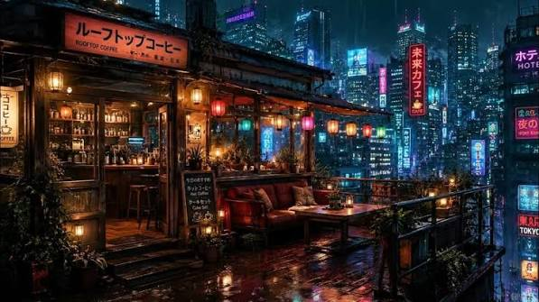

# YANGON: Life above the neon

Game Concept and Development Plan - PDF reference conversion

**Source:** version 1.0, 18 November 2026; cover plus 25 numbered content pages.

[Original PDF](<C:/Users/khant/Downloads/Yangon_YUST_Game_Concept_and_Development_Plan.pdf>)

> This is the original planning reference, not a new set of instructions or a replacement for current project decisions. Its CONFIRMED, PROPOSED and OPEN distinctions are retained. The PDF originally described pixel art and left the engine/camera open. The current project has subsequently chosen Godot 4, 3D models and a fixed high camera; see [GameConcept.md](GameConcept.md), [framework.md](framework.md) and [FirstDistrict.md](FirstDistrict.md). The final title and YUST name/acronym remain provisional.

The cover subtitle is editorial; the reference image supplied by the user is a mood reference, not an approved production asset.

---

## 01. Concept at a glance

*01 / THE GAME; PDF printed page 01 / 25.*

A warm home above a neon city. A student life worth protecting.

A PC game about a 17-year-old YUST student living in a futuristic Yangon. Attend relaxed classes, build friendships and romance, help at your family’s rooftop café, earn money, drive with friends, and learn to pilot a mecha that defends the city’s outskirts.

### The player promise

Enjoy everyday life in a city that feels inhabited. Progress through easy school activities and personal choices. Mecha training and occasional alien incursions provide adventure without replacing the cozy student experience.

| Element | Current direction |
| --- | --- |
| Genre | Cozy sci-fi student life simulation with mecha activities |
| Platform | PC; operating systems and storefront remain undecided |
| Visual direction | Original pixel art inspired by the atmosphere and environmental richness you associate with Witchbrook |
| Setting | Fictional future Yangon, with Myanmar names and cultural identity |
| Main character | 17-year-old student at Yangon University of Science and Technology (YUST) |
| Home | Family apartment and family-run rooftop café |
| Time | 30 real minutes per full day-night cycle: working interpretation |
| Threat | Alien incursions around Yangon, approximately 2-3 per in-game month |

### Document status

Concept and planning draft v1.0 • 18 November 2026. This is a working design document, not a locked production specification. The game has no confirmed title. YUST is used here as your fictional institution; its name and acronym are provisional.

---

## 02. How to use this plan

*02 / DECISIONS & CONTENTS; PDF printed page 02 / 25.*

Your ideas are preserved as the foundation. Additional mechanics below are explicitly proposals so they can be accepted, changed, or removed without rewriting your vision.

| Label | Meaning |
| --- | --- |
| CONFIRMED | You explicitly requested or accepted this direction in our conversation. |
| PROPOSED | A concrete design recommendation added to make the concept playable. |
| OPEN | A choice we have not settled. No implementation commitment yet. |

### Reading guide

| Pages | Topic |
| --- | --- |
| 3-5 | Vision, confirmed features, connected gameplay loop |
| 6-8 | Yangon layout, art direction, rooftop home and café |
| 9-12 | Time, YUST classes, mecha progression and school matches |
| 13-16 | Alien incursions, NPCs, friendships and romance |
| 17-19 | Jobs, purchases, driving, transport and traffic |
| 20-23 | Reusable systems, first playable version, build order and validation |
| 24-25 | Open decisions, next planning session and example play day |

### Design boundaries

- This concept remains separate from your Zaw Gyi project. No characters, lore, or release assumptions are carried over.

- Witchbrook, Evangelion, and Darling in the Franxx are references for selected feelings or ideas, not templates for copying characters, assets, storylines, or distinctive mecha designs.

- The café reference image is supplied by you; its creator and usage rights are unverified. Use its mood for discussion, then create original production art.

No current product claims, engine comparisons, budgets, or market forecasts are asserted here. All numerical balancing examples are provisional design targets.

---

## 03. Design pillars

*03 / WHAT HOLDS THE GAME TOGETHER; PDF printed page 03 / 25.*

### 1. A home worth returning to

The rooftop café and apartment provide continuity. Warm light, familiar customers, family conversations, plants, food, and the city view create a dependable emotional centre. Mecha progression should make this everyday world feel meaningful.

### 2. A distinctly Myanmar future

Develop the setting from Yangon’s social life, food, language, everyday clothing, rain, greenery, and gathering places. Give futuristic technology a local purpose rather than covering a generic city with Burmese signs. Exact names, districts, and cultural details need your review.

### 3. Student growth without pressure

Regular attendance and easy practical tasks improve pilot skills. Activities should be short and understandable, with generous retries. Missing a lesson should offer a catch-up opportunity rather than permanently blocking a mechanic.

### 4. A connected, inhabited city

Height differences, bridges, transit, traffic, gardens, lakes, animals, and purposeful NPC activity should work together. A smaller neighbourhood with consistent behaviour can feel richer than a large map full of decorative characters.

### 5. Relationships through shared life

Build connection through repeated encounters, café visits, classes, rides, training, and optional romance. Characters need goals and relationships that continue when the player is elsewhere.

### 6. Mecha as part of life

Classes, engineering, friendly matches, and external defence missions connect mecha play to school and friends. Combat difficulty, mandatory missions, and loss consequences remain open.

### Feature filter

Before adding a feature, ask: does it strengthen home, student life, the city, relationships, or mecha growth? What other systems must support it? Can we prove its value with one small example?

---

## 04. Confirmed feature register

*04 / THE CURRENT VISION; PDF printed page 04 / 25.*

| Area | Confirmed direction |
| --- | --- |
| World | Cyberpunk Yangon with natural-looking changes in elevation, staircases, bridges and skybridges connecting skyscrapers. |
| Green spaces | Flowerbeds, gardens, lakes, living animals and everyday activity within the futuristic city. |
| Player and school | 17-year-old YUST student. The university is famous for mecha training. |
| Home | The player’s family operates a cozy café at their rooftop apartment. |
| Daily experience | Witchbrook-inspired student and city life in a futuristic setting; full day-night cycle intended to last around 30 real minutes. |
| People | Interactive, smart-feeling NPCs, friendships, and some romance relationships. |
| Economy | Jobs and earnings; outfits, vehicles and properties available for purchase. |
| Mobility | Futuristic transport and traffic; owned vehicles can be driven, and NPCs can ride with the player. |
| Pilot growth | Regular classes improve skills, control and available mecha mechanics. School tasks should be easy. |
| Activities | School activities include friendly mecha matches. |
| Conflict | Aliens invade Earth; mecha defend the outskirts around Yangon. Roughly 2-3 incursions per month, outside the literal city. |
| Build approach | Start with one complete example per function, then add more content through reusable systems and data. |

### Not confirmed yet

Exact camera and movement style; engine; mecha combat format; mecha ownership; optional or mandatory defence missions; names and number of key NPCs; romance rules; total city size; property progression; economy values; calendar length; final game title.

---

## 05. The connected gameplay loop

*05 / DAILY LIFE → GROWTH → ADVENTURE; PDF printed page 05 / 25.*

| Loop | Actions | What changes |
| --- | --- | --- |
| Daily life | Wake at home; travel; attend a class; see friends; work or explore; return to café. | Money, relationships, familiarity with the city. |
| Pilot growth | Attend easy exercises; practise unlocked moves; join a friendly match. | Pilot experience, equipment knowledge, new options. |
| Personal growth | Earn money; choose clothes; decorate; save for transport or property. | Identity, convenience, personal space. |
| Periodic events | Campus celebrations, optional outings, external invasion alerts. | New conversations, story progress, changing routines. |

### One activity should support several systems

A classmate asks for a ride after training. Picking them up uses the driving and passenger systems. Visiting the café advances a social event, introduces their preferred order, and gives your family something new to discuss. This creates depth through connections rather than separate minigames.

### Suggested progression layers

- Short term: finish an easy exercise, serve a few orders, meet a friend, or buy an outfit.

- Medium term: learn a new mecha action, improve a friendship, save for a vehicle, or qualify for a school event.

- Long term: complete a semester storyline, become a capable pilot, and pursue housing or relationship goals.

### Avoid an overloaded daily checklist

Do not require the player to study, work, train, date, maintain a vehicle, and complete a mission every day. Offer choices. Required story moments should be clearly communicated and should leave room for free time.

### Progression rule

Attendance can provide steady experience; small practical tasks make progress feel earned. Avoid selling essential pilot competence through money alone. Keep optional purchases and core learning understandable.

---

## 06. Yangon: a city with layers

*06 / WORLD STRUCTURE; PDF printed page 06 / 25.*

CONFIRMED: natural-feeling high and low terrain, stairs, bridges, skybridges, gardens, lakes and daily life. PROPOSED: build the first map as a compact set of connected neighbourhood spaces.

| Layer | Places and movement | Design purpose |
| --- | --- | --- |
| Street level | Shops, café entrances, crossings, buses, cars and delivery stops. | Everyday life and active streets. |
| Sloped neighbourhoods | Terraces, stairways, planted edges and accessible alternate routes. | Natural elevation and memorable landmarks. |
| Tower level | Indoor lobbies, lifts, skybridges and shared gardens. | Vertical exploration and shortcuts. |
| Rooftops | Family café, seating, utility corners and private gardens. | Warm social spaces above the traffic. |
| Water and parks | Lake paths, gardens, quiet seating; ferry only if useful. | Rest, animals and slower social moments. |
| Outer defence zone | Training grounds and mission areas beyond the inhabited centre. | Separate the battle space from daily routines. |

### Proposed first district

Place the family building, one transit stop, a small shopping street, one garden or lake edge, and a YUST entrance close enough to support several activities in one day. Use one tower-to-tower skybridge to prove the vertical navigation system.

### Route clarity

Give every bridge a visible entrance and destination. Use consistent signs, recognizable shop fronts, lift markers and map icons. Where stairs create a height change, make the landing and walking direction obvious. Gardens and ramps can provide alternative routes.

### Geographic flexibility

Treat the city as a fictional future interpretation of Yangon. Stronger hills or major engineered terraces should be an intentional setting choice, not an accidental claim that the map recreates present-day geography.

---

## 07. Art, atmosphere and reference

*07 / ORIGINAL PIXEL-ART DIRECTION; PDF printed page 07 / 25.*

CONFIRMED: Witchbrook-inspired graphics and environmental design, translated into a cozy cyberpunk Yangon. OPEN: precise camera angle, pixel density, sprite proportions and animation budget.

User-supplied rooftop café reference. Mood reference only: not a pixel-art target or an approved production asset.

### Translate the mood into the game

- Warm amber café interiors against cool blue-green city lights; warm windows should guide the eye toward social spaces.

- Plants, worn surfaces, awnings and personal objects keep technology lived-in. Use rain reflections selectively so paths remain readable.

- Build an original Myanmar visual vocabulary through reviewed clothing, food, signage, interiors and architecture. Avoid copying the reference image’s Japanese text.

### Readability before decoration

Foreground towers, bridge decks and roofs should fade or cut away when they hide the player. Distinguish walkable bridges from background structures. Keep vehicles, pedestrians and interactable objects visible under night lighting.

---

## 08. The apartment and rooftop café

*08 / HOME & FAMILY; PDF printed page 08 / 25.*

CONFIRMED: your family owns or runs a cozy rooftop café at the apartment building. OPEN: who lives there, ownership details, family names, the café menu and whether the player has a separate room.

### Suggested spaces

| Space | Player use |
| --- | --- |
| Player room | Change outfits, store items, view messages, save and sleep; decoration is proposed. |
| Family area | Morning conversations, shared meals and story scenes. |
| Café counter | Take orders, prepare simple drinks, collect supplies and work an optional shift. |
| Covered terrace | Meet friends, enjoy rain, host small social events. |
| Rooftop garden | A quiet resting area and a visual link to the city’s greenery. |
| Building entrance | Access stairs or lift, deliveries, nearby transit and designated parking. |

### Simple café work: proposed first activity

Start a short shift voluntarily. Read an order, choose the correct drink or snack, and deliver it to a clearly marked table. Use a small menu and forgiving timing. Reward completion with money and a short customer interaction, not a stressful queue.

### The café as a social hub

Regulars arrive at recognizable times. Classmates may visit after training; a family member notices a new friendship; a customer shares a small local request. Café dialogue can reference school events and completed missions without turning every customer into a quest giver.

### Food direction

Use a locally grounded menu chosen with you. Myanmar tea and snacks are promising starting points, but exact recipes, names, visuals and café identity remain to be designed.

### Protect the home feeling

Do not make the family lose the café because the player skips a shift. It should remain a dependable place to return to while optional improvements create long-term goals.

---

## 09. Clock, calendar and everyday pacing

*09 / A 30-MINUTE DAY; PDF printed page 09 / 25.*

CONFIRMED: a day-night cycle around 30 minutes. WORKING INTERPRETATION: 30 real minutes for a full 24-hour game day. We still need to confirm whether you meant the full cycle or each half.

| Clock assumption | Consequence |
| --- | --- |
| 24 game hours = 30 real minutes | 1 game hour = 75 real seconds; 1 game minute = 1.25 real seconds. |
| Awake from 07:00 to 23:00 | 16 game hours = 20 real minutes of ordinary awake time before pauses. |
| An activity takes 30-60 real seconds | It occupies about 24-48 game minutes if time flows normally. |

### Proposed comfort rules

- Pause the world clock during dialogue, inventory, shopping menus and pause screens.

- Use safe fixed time costs or paused instanced time for classes and friendly matches so a short exercise does not consume an unpredictable part of the day.

- Give classes broad attendance windows and catch-up options. Clearly show when an activity advances time.

- Provide a useful transit option and a quick return-home route; walking should not consume most of the available day.

- Consider a slower optional clock after playtesting rather than assuming 30 minutes will suit everyone.

### Calendar and invasion spacing

Month length is OPEN. For illustration only, a 28-day month with 2-3 incursions averages roughly one incursion every 9-14 days. In an unpaused 30-minute cycle, the month is 14 real hours; sleeping and activity time jumps reduce that. Event spacing therefore needs playtesting.

### Save and sleep

PROPOSED: manual saves at safe moments plus autosaves at activity boundaries. Sleeping advances to morning; it should not silently skip an already accepted important event without warning.

---

## 10. YUST campus and student activities

*10 / SCHOOL AS A PLACE TO LIVE; PDF printed page 10 / 25.*

CONFIRMED: YUST is famous for mecha training, alongside the science and technology identity in its name. Lessons are easy tasks; school activities include friendly mecha matches.

| Campus area | Purpose |
| --- | --- |
| Teaching room | Short lessons, announcements and classmates. |
| Simulator room | Safe piloting exercises and repeatable practice. |
| Engineering workshop | Simple repairs, part matching and equipment introductions. |
| Training arena | Friendly matches and school challenges. |
| Student commons | Lunch, clubs, friendships and informal events. |
| Campus garden / transit entrance | Relaxed meeting places connected to the wider city. |

### Proposed weekly rhythm

Offer a small selection of class windows across the week, with open periods for work and social life. Announce school events early. Allow the player to repeat a practice exercise without repeating its full dialogue.

### Other possible school activities

- Engineering club: assemble a small helper robot or contribute to a café device.

- Campus festival: class stalls, food, simple games and an exhibition match.

- Study group: a short conversation or cooperative task that also builds friendship.

- Mecha showcase: view student builds, discuss equipment and discover cosmetic goals.

### First implementation

Use one campus room, one instructor, one classmate and one easy pilot activity. The rest can exist as announced locations until the school loop is enjoyable. Suggested locations and clubs are proposals, not mandatory content.

### Story tone

Instructors can take defence seriously while treating students supportively. Explain training safety and why a first-year student becomes involved in any actual deployment; that story justification remains open.

---

## 11. Easy classes and pilot progression

*11 / LEARN BY DOING; PDF printed page 11 / 25.*

CONFIRMED: attending classes regularly increases skill, improves mecha control and opens more mechanics. Tasks should be easy rather than demanding exams.

| Class | Simple exercise | Possible reward |
| --- | --- | --- |
| Piloting | Walk through a few wide checkpoints. | Movement experience; later a controlled boost. |
| Target practice | Shoot several stationary targets with generous aim assistance. | Weapon experience; later another weapon option. |
| Engineering | Match a clearly illustrated part to its slot. | Workshop experience; later a tuning slot. |
| Energy management | Move a slider into a large marked safe zone. | Energy experience; later power distribution. |
| Teamwork | Follow a classmate to a marker and activate a shared target. | Coordination experience; later a partner command. |

### Proposed progression rules

- Each completed lesson adds modest experience. Track subject progress visibly so the player knows what a class teaches.

- Unlock major mechanics through a brief guided introduction after enough participation. No difficult test is required.

- Make repeated classes available, while limiting repetitive rewards if grinding becomes the dominant strategy.

- Separate pilot knowledge from equipment purchases: learning enables options, while equipment changes how those options work.

### Control should feel good from the start

Begin with responsive movement, reliable aiming and readable actions. Improved piloting should add options or efficiency, not remove artificial input lag, random steering or frustrating inaccuracy.

### Provisional task duration

A suggested first target is 30-60 seconds per interactive exercise, excluding dialogue. Retry immediately, avoid harsh timers, and award basic progress for supported completion. Tune length against the daily clock.

---

## 12. Mecha training and friendly matches

*12 / SCHOOL COMPETITION; PDF printed page 12 / 25.*

CONFIRMED: students can take part in friendly mecha matches. OPEN: combat camera, 2D versus 3D presentation, number of pilots per mecha, match controls and overall combat depth.

| Activity | Proposed rules | Purpose |
| --- | --- | --- |
| Friendly duel | One classmate, small arena, short rounds, no repair bill. | Learn controls and develop a school rivalry or friendship. |
| Target challenge | Stationary or slow targets; generous completion target. | Practice without combat pressure. |
| Obstacle course | Wide gates and easy movement challenges. | Show improvement after new movement unlocks. |
| Team exercise | Add only after solo combat works. | Make classmates useful partners. |
| Campus tournament | Occasional event rather than a daily obligation. | Give training a visible social milestone. |

### The first match

Build one mecha, one opponent, one arena and a tiny action set: movement, basic attack and one defensive action. Provide a short tutorial and clear target feedback. A rematch should be quick to start. Any proposed 2-4 minute match duration is a test target, not a locked rule.

### Cozy consequences

PROPOSED: friendly matches are optional. Completing one earns a small reward; winning gives a modest bonus. Losing does not damage relationships, destroy equipment, remove money or block school progress.

### Difficulty separation

Your request for easy tasks is confirmed for classes. It does not yet define real battle difficulty. Keep settings flexible until you choose whether defence combat should be relaxing, moderately challenging, or mostly story-led.

### Mecha identity

The chassis design, scale, weapons, pilot interface and university ownership rules need original decisions. Start with a school training machine; personal ownership can be considered after the core loop works.

---

## 13. Alien incursions beyond Yangon

*13 / PERIODIC DEFENCE EVENTS; PDF printed page 13 / 25.*

CONFIRMED: aliens threaten Earth and mecha fight back. Around Yangon, incursions occur approximately 2-3 times per month, mainly outside the city rather than inside its streets.

### Suggested event sequence

| Stage | Player-facing experience |
| --- | --- |
| Notice | An alert announces activity beyond the city. Transit screens and school messages explain what is happening. |
| Preparation | A clear opportunity to save, check equipment and meet the assigned team. |
| Deployment | Transition to a separate outer defence area; city traffic and combat need not share one simulation. |
| Mission | A contained objective such as defend a perimeter or intercept a threat. Exact combat remains open. |
| Return | Debrief, rewards and conversations that acknowledge the event. |
| Recovery | Calm campus and café activities restore the everyday rhythm. |

### Why everyday life can continue

Establish the defended perimeter, alert procedures, reliable transport information and the role of trained forces. The city does not need to be perfectly unaffected: distant sounds, worried conversations and temporary route changes can acknowledge danger without constant destruction.

### Frequency and freedom

OPEN: whether every incursion requires player involvement. A strong proposed structure is mandatory participation only for selected story missions, with other incidents handled by established teams or offered as optional deployments. This preserves school and café life.

### Protect the tone

Do not introduce civilian deaths, permanent companion loss or destroyed player property by default. These would materially change the cozy promise and need a deliberate story decision.

### Student deployment logic

Before writing the first real mission, decide the training threshold, supervision and story reason that lets a 17-year-old participate. Simulator-only early progression is a proposed way to establish competence first.

---

## 14. Smart-feeling NPCs

*14 / PEOPLE WITH ROUTINES & MEMORY; PDF printed page 14 / 25.*

CONFIRMED: good, interactive and smart-feeling NPCs. PROPOSED IMPLEMENTATION: authored schedules, event memory and contextual responses. Live language-model dialogue is not required to achieve this and has not been selected.

| Layer | Behaviour |
| --- | --- |
| Routine | Move between home, class, work, transit, food and leisure according to a schedule. |
| Personality | Interests and traits influence preferred activities, dialogue and reactions. |
| Memory | Remember completed requests, accepted invitations, rides and meaningful story events. |
| Context | React to time, weather, location, friendship and recent incursions. |
| Social ties | Have classmates, family, friends and rivals independent of the player. |
| World use | Sit, shop, board transport, shelter from rain and visit the café. |

### Important distinction

Schedule and reaction data can make many characters share a reliable system. Each major character still needs authored dialogue, memorable scenes and a clear identity. Adding a row of personality labels alone does not create believable depth.

### Consistency rules

- An NPC invited into your vehicle becomes a passenger and temporarily suspends their ordinary travel schedule.

- Accepted activities reserve that character for a defined window. If they cannot attend, communicate the reason.

- Weather and alerts can redirect routines, but new destinations should remain discoverable.

- Do not let NPCs teleport within the player’s view; simplify unseen travel where it does not break an agreed activity.

### Suggested cast strategy

Start with one deeply implemented classmate, one family member and a small ambient population. Expand toward a modest recurring cast only after routines, dialogue and invitation states behave consistently.

---

## 15. Interactions, invitations and city life

*15 / MAKING NPCS FEEL PRESENT; PDF printed page 15 / 25.*

### Proposed interaction menu

Keep everyday interactions readable: Talk, Invite, Offer Ride, Ask About Schedule and Give Item can appear when relevant. Avoid showing unavailable actions without a clear reason.

| Situation | Suggested response |
| --- | --- |
| You arrive before class | A classmate comments on the upcoming exercise or asks to walk together. |
| You bring them to the café | They meet a family member and choose an order; later dialogue can recall the visit. |
| It starts raining | Pedestrians seek shelter and a friend suggests a covered route. |
| You miss an invitation | A mild follow-up acknowledges it; give a chance to reconnect. |
| You unlock a pilot mechanic | An instructor or training partner notices the improvement. |
| A defence mission ends | Relevant people react to your participation, not merely a generic world flag. |

### Animals and ambient behaviour

CONFIRMED: lively animals. PROPOSED: cats rest near warm machinery, birds perch on skybridges, and small animals move through gardens. Start with one animal species and a few behaviours. Pet ownership, feeding systems and animal care are optional future decisions.

### Crowd simulation

Use detailed persistence for key characters. Background commuters can follow short routes and perform limited interactions near the player. They should obey crossings and use believable destinations without needing a full private life for every individual.

### Dialogue priority

Use an explicit rule order: urgent activity or alert message, accepted invitation, personal event, location-specific comment, then ordinary conversation. Record one-time scenes so they do not repeat. Always provide a usable exit from dialogue.

### Avoid social overload

Friends can initiate occasional plans, but constant requests would turn social life into notifications. Limit simultaneous invitations and let the player decline kindly.

---

## 16. Friendship and romance

*16 / OPTIONAL RELATIONSHIPS; PDF printed page 16 / 25.*

CONFIRMED: some romance relationships. OPEN: romance cast, genders, player customisation, exclusivity, relationship milestones and number of options.

### Suggested relationship progression

| Stage | Example content |
| --- | --- |
| Acquaintance | Meet in class or at the café; learn a name and interest. |
| Familiar friend | Recognise routines; share easy tasks and ordinary conversation. |
| Close friend | Personal stories, shared outings and mutual support. |
| Romantic interest | Optional, clearly signalled choices for similarly aged peers. |
| Relationship | Recurring time together, dates and individual character story events. |

### Activities grounded in this world

- Ride together after training; stop at a lakeside food stall or a skybridge garden.

- Study or repair a small device at the café during rain.

- Attend a school event, friendly match or festival together.

- Share a quiet conversation after a difficult day or a successful mission.

### Relationship design rules

The protagonist is 17, so romance should be non-explicit and with similarly aged peers. Keep instructors outside romance options. Let players remain friends and experience a character’s main personal story without dating them.

### Memory and mutuality

Meaningful support, fulfilled invitations and dialogue choices should matter. Gifts can help, but should not act as a machine for purchasing affection. Characters can have preferences and boundaries without punishing the player for every small mistake.

### Production scope

A small set of well-written relationships is preferable for the first release. The earlier suggestion of three romance options is not a confirmed requirement. Each option needs its own dialogue, activities, events and state testing.

---

## 17. Jobs, money and purchases

*17 / A STUDENT ECONOMY; PDF printed page 17 / 25.*

CONFIRMED: jobs earn money; outfits, vehicles and properties can be bought. OPEN: currency name, pay, prices, job count, property restrictions and whether there are recurring expenses.

| Job proposal | Easy activity | System connection |
| --- | --- | --- |
| Family café | Serve a few clearly shown orders. | Family, customers and café scenes. |
| Campus helper | Deliver materials or organise components. | YUST exploration and classmates. |
| Robot repair | Match parts or follow a short repair sequence. | Engineering practice and local residents. |
| Tutoring | Complete an easy guided exercise with another student. | Academic identity and friendship. |
| Local delivery | Carry a small order along a familiar route. | Walking or later vehicle use. |

### Proposed purchase ladder

Use frequent affordable purchases for self-expression and larger savings goals for mobility and housing. Clothes and café treats offer early rewards; a scooter or car creates a medium-term goal; property can be a later milestone.

### Economy balancing method

Define prices in units of enjoyable work sessions before choosing a currency. For example only: one basic outfit might cost 1-2 short shifts, a starter vehicle 10-15, and housing much more. These are placeholders to test, not final values. Avoid requiring monotonous shifts for every meaningful purchase.

### Keep work optional

Do not require daily shifts to pay for basic school access or retain the family home. Flexible work windows should leave room for classes and relationships. Mission rewards may help, but should not make civilian jobs irrelevant.

### Transaction integrity

Purchases need clear prices, insufficient-funds feedback, ownership records and reliable saving. Prevent accidental double charges and duplication when loading after a transaction.

---

## 18. Outfits, vehicles and properties

*18 / PERSONAL OWNERSHIP; PDF printed page 18 / 25.*

### Outfits: confirmed purchase category

PROPOSED: everyday fashion, original futuristic Myanmar-inspired clothing, accessories and pilot-suit cosmetics. Start with a few complete outfits rather than interchangeable layers if layering multiplies animation work. Clothing statistics and uniform restrictions remain open.

### Vehicles: confirmed purchase and driving

Ownership should create convenience and shared experiences, not just a garage icon. Let the player select a vehicle, find it at a valid location, drive it, park, invite an eligible NPC and travel together. First build one small car; multiple colours or similar cars can follow through data.

### Properties: confirmed goal, progression open

| Proposed stage | What it provides |
| --- | --- |
| Family room | A dependable starting space and place for personal belongings. |
| Rentable studio | An optional intermediate goal, if renting supports the game. |
| Owned apartment | A major savings goal with a usable interior. |
| Additional properties | Only if they add distinct activities; avoid empty purchases. |

### Student ownership needs a world rule

Because the protagonist is 17, explain ownership through the fictional setting: family-supported purchase, a future legal arrangement, or unlocking ownership after a time jump are possible approaches. None is selected yet. Renting is a proposal, not a replacement for your purchase idea.

### Customization scope

A small interior decoration system can make property worthwhile, but it is additional work: placement, collision, furniture ownership and saving. Test a limited grid or fixed furnishing slots before promising free placement everywhere.

### Do not create empty progression

A new home should offer a new experience or meaningful personal space. A vehicle should change travel. Outfit changes should be visible in common scenes. Tie purchases to the player’s lived routine.

---

## 19. Driving, passengers and transport

*19 / MOVING THROUGH YANGON; PDF printed page 19 / 25.*

CONFIRMED: futuristic vehicles, traffic, public transport, player driving and NPC passengers. The specific vehicle roster remains proposed.

| Vehicle proposal | Role | Build priority |
| --- | --- | --- |
| Small electric car | First owned drivable vehicle with one passenger. | First complete example |
| Electric bus or tram | Affordable scheduled travel between key places. | One route after walking loop |
| Hover scooter | Near-ground student transport using road lanes. | Later variant; unique movement needs work |
| Elevated train | Long-distance district connection and skyline views. | Later expansion |
| Delivery cart | Ambient supplies and café activity. | Simple ambient route |
| Lake ferry | Useful only if waterways support destinations. | Optional |

### Passenger flow

Invite an available NPC; confirm destination; walk to a valid parked vehicle; board if a seat is free; suspend their normal route; play limited contextual conversation; stop at a safe parking point; let both characters exit; resume or update their shared activity.

### Traffic rules

Start with road lanes, intersections, traffic signals, crossings, queueing and obstacle stopping. Spawn ambient traffic outside view where possible. Simulate nearby vehicles in detail and simplify distant traffic. A vehicle should not drive through a passenger during boarding.

### Cozy driving proposal

Use forgiving handling, moderate speeds and clear road boundaries. Severe crashes, damage costs, fuel, insurance, police systems and racing are not confirmed and should not be added automatically.

### Vertical city rule

Ordinary vehicles stay on roads and approved ramps. Skybridges are pedestrian spaces unless explicitly designed for traffic. Fully flying vehicles require different controls, navigation and camera support; they are not just another car data entry.

---

## 20. Reusable systems and data

*20 / ONE EXAMPLE, THEN EXPAND; PDF printed page 20 / 25.*

CONFIRMED BUILD APPROACH: implement one working example for each function, then expand. The critical distinction: data adds supported content; new behaviour still needs code, art and verification.

| Reusable system | Suggested data | Behaviour that still needs implementation |
| --- | --- | --- |
| Vehicle | ID, sprite, speed, seats, price, sound, unlock. | Driving, braking, parking, collision and boarding. |
| NPC | ID, portrait, schedule, interests, dialogue and event references. | Navigation, availability, memory and interaction priority. |
| Class | Subject, task scene, reward, timetable and prerequisites. | Minigame rules, completion and skill unlocks. |
| Job | Location, task, pay, window and repeat limit. | Work flow, cancellation and payment. |
| Property | ID, price, entrance, interior and furnishing rules. | Purchase, access, ownership and saving. |
| Mecha ability | ID, input, energy cost, animation and prerequisites. | Actual movement, attacks and effects. |

### Shared state is the foundation

Use stable IDs for characters, vehicles, locations and items. Separate static definitions from saved state: a car’s base price belongs in content data; the player’s purchased car and current parking location belong in the save. NPC relationship progress should not live inside a dialogue text file.

### Connected events

Activities can emit events such as ClassCompleted, RideFinished, ItemPurchased and IncursionResolved. Relevant systems respond to those events rather than each feature directly changing every other system. The exact implementation depends on the engine you choose.

### Save requirements

Persist clock, calendar, location, money, inventory, ownership, skills, relationship flags and accepted activities. Save enough transport state to prevent a passenger becoming stranded after loading. Use versioned save formats and safe migration as content grows.

---

## 21. First playable vertical slice

*21 / A SMALL VERSION OF THE WHOLE IDEA; PDF printed page 21 / 25.*

PROPOSED: build a compact playable route that connects home, school, people and mecha growth. This is a development milestone, not the full game or a promise of launch content.

| Feature | One complete example | Success condition |
| --- | --- | --- |
| World | One neighbourhood, a slope or stair, one skybridge and a small garden. | Routes are readable and the player is never hidden. |
| Home / café | One room and one optional serving task. | Start, complete, earn pay and save reliably. |
| School | One classroom and one easy piloting exercise. | Attend and gain a visible skill improvement. |
| NPC | One classmate with routine, context dialogue and invitation. | They appear where expected and recall the shared event. |
| Driving | One car, one passenger and two parking points. | Invite, board, travel, exit and resume activity. |
| Economy | One job and one outfit purchase. | Money and appearance persist after loading. |
| Mecha | One training machine, opponent and arena. | A short friendly match is understandable and replayable. |
| Time / life | Clock, night lighting, one animal and a small crowd. | The environment changes without breaking activities. |

### Build the loop, not isolated demos

A useful slice is: leave home, attend a short class, invite a classmate, drive to the café, work a shift or socialise, buy an outfit, return home and save. A separate training arena proves mecha play. Check that all progress survives loading.

### Defer until the slice works

Multiple districts, large relationship cast, multiple properties, flying vehicles, team combat, complex decoration and repeated incursion content. Keep them in the vision, but do not let them block the first playable loop.

---

## 22. Build order and dependencies

*22 / FROM CONCEPT TO A WORKING GAME; PDF printed page 22 / 25.*

| Stage | Build | Completion gate |
| --- | --- | --- |
| 1. Set the foundations | Choose engine and camera; test pixel art, slopes, bridges and walking. | You can navigate a small layered map clearly. |
| 2. Establish state | Clock, interaction, transitions, money and save/load. | A purchase and time change survive loading. |
| 3. Complete home-school loop | Café task, class task, skill progress and one NPC routine. | A relaxed day has meaningful choices. |
| 4. Prove driving early | One car, lane traffic, parking and NPC boarding. | Drive between two places with a passenger. |
| 5. Prove mecha play | Training room, basic controls, one easy exercise and friendly duel. | Mecha control feels good before content expansion. |
| 6. Connect social events | Invitations, shared rides, café scenes and relationship memory. | Activities do not conflict with schedules. |
| 7. Test one external mission | Alert, preparation, separate defence area and return scene. | The city stays coherent through the event. |
| 8. Expand from evidence | More NPCs, classes, vehicles, purchases and neighbourhoods. | New content reuses systems without repeated special cases. |

### No reliable calendar estimate yet

Engine choice, available time, art production method and mecha presentation are unknown. Estimate work after the first world, driving and combat prototypes show the real content cost. PC capability does not remove production and integration work.

### Technical decision to make early

A pixel-art city with a separate mecha arena is a practical architecture to test. Whether that arena is 2D or 3D remains open. A hybrid presentation may work, but creates separate art, camera and animation needs; do not assume it is free.

### Scope rule

Add content once the shared behaviour works. Add a new system only when you can explain its role, dependencies, smallest useful example and completion test.

---

## 23. Quality checks and design risks

*23 / WHAT MUST FEEL RIGHT; PDF printed page 23 / 25.*

| Risk | Design response | Verification |
| --- | --- | --- |
| Days feel rushed | Pause menus and dialogue; flexible class windows; short trips. | Can a new player finish a class and one chosen leisure activity comfortably? |
| Art hides movement | Fade foreground objects; distinct elevations and crossings. | Walk behind every tall structure and across each bridge. |
| NPCs feel inconsistent | Availability rules, schedule overrides and event memory. | Invite someone before class, in rain and during an alert. |
| Passengers break routines | Explicit boarding, seat, travel and exit states. | Save and load while parked with a passenger. |
| Combat overwhelms cozy life | Separate training and defence spaces; forgiving school matches. | Does a loss still allow a satisfying ordinary day? |
| Economy becomes grinding | Price goals against short enjoyable jobs. | Track how many repeated shifts each purchase requires. |
| Feature count stalls progress | Small connected slice before content expansion. | Can one full day be played before adding another district? |
| Performance drops | Limit active traffic and crowds; simplify distant simulation. | Profile busy crossings and campus dismissal on chosen target PCs. |

### Comfort and accessibility proposals

Remappable controls; readable UI at common PC resolutions; adjustable text size; reduced flashing and screen shake; subtitles; clear interact prompts; optional aim assistance. Controller support is an open platform decision.

### Meaningful integration checks

Test class completion during a time transition; an invitation that overlaps a schedule change; a purchase immediately before saving; NPC boarding near moving traffic; stairs and bridges at night; and city return after a defence mission. These reveal connected failures that isolated content checks miss.

### Production art caution

Every outfit, vehicle and mecha may need several directions, animation states and lighting-friendly versions. Reusable data reduces coding effort, but does not automatically create those assets.

---

## 24. Open decisions and next steps

*24 / WHAT WE SHOULD PLAN NEXT; PDF printed page 24 / 25.*

| Decision | Current position / suggested next move |
| --- | --- |
| Game title | No title selected. Keep Yangon and YUST as setting identifiers. |
| Camera | Test a pixel-art view that supports walking, elevation and driving. |
| Engine | Undecided. Choose after a small camera, driving and mecha feasibility test. |
| Mecha presentation | Decide 2D arena, 3D arena, or another format before building combat assets. |
| Time interpretation | Confirm full 24-hour cycle = 30 real minutes, plus pause rules. |
| Calendar | Choose days per month, school week and event frequency. |
| Player identity | Choose customisation, name, pronouns and backstory. |
| Family and café | Choose family members, café name, menu and home layout. |
| First classmate | Define one personality, routine, interests and a shared activity. |
| Mecha combat tone | Choose difficulty and how compulsory real deployments are. |
| Housing | Decide when a student can buy property and what it enables. |
| Production limits | Set team size, weekly hours, art approach and target hardware. |

### Recommended next planning session

Draw the first neighbourhood: apartment/café, YUST entrance, one shop, one transit stop, one parking area, one garden and one skybridge. Then define the first ordinary day and the first classmate. That gives every initial feature a real place and purpose.

### Reusable feature card

For each new idea record: player action; reason to include it; location; related NPC; required systems; smallest complete example; content data; save state; completion check; and release priority. Keep ideas welcome while making their implementation cost visible.

---

## 25. An example day in your Yangon

*25 / A PLAYABLE FEELING; PDF printed page 25 / 25.*

Illustrative sequence only. Characters, timing, rewards and events below are proposals rather than new confirmed lore.

### Morning above the city

You wake in the apartment while the rooftop café opens. The city beyond the terrace is cool and misty; the counter glows warmly. A family member mentions a delivery and asks whether you will be home after class. You choose an outfit and check the day’s school activity.

### The journey to YUST

You walk down the building stairs, pass a garden and cross at a signal. Commuters board a futuristic bus. A cat sleeps beside a charging point. You can take transit, walk across a skybridge, or use your parked car if you own one.

### A short lesson

At YUST, you guide a training mecha through broad checkpoints. The task is easy, with clear prompts and retries. Completing it increases pilot experience and introduces a new movement option once its prerequisite is met. A classmate invites you to try a friendly match another day.

### An afternoon choice

You could work a short campus job, visit the lake, practise, or spend time with a friend. Today you offer your classmate a ride to the café. They board at a marked parking place; their ordinary travel schedule pauses while the outing is active.

### Evening at the café

Rain begins as you reach home. Your friend takes a covered terrace seat. You complete a small serving task, earn money and hear a new conversation. The city lights change as evening approaches. Buying an outfit or saving toward your next vehicle becomes a personal choice.

### The wider world

On an incursion day, an announced defence event may interrupt this rhythm in a controlled way. The battle happens outside Yangon. After returning, schoolmates and family acknowledge it, and familiar home activities provide a calm landing.

### The test for every future feature

Does it make this life richer, give the player a meaningful choice, or strengthen the people and places they care about? If it does, keep it in the vision and find its smallest playable form.

---
